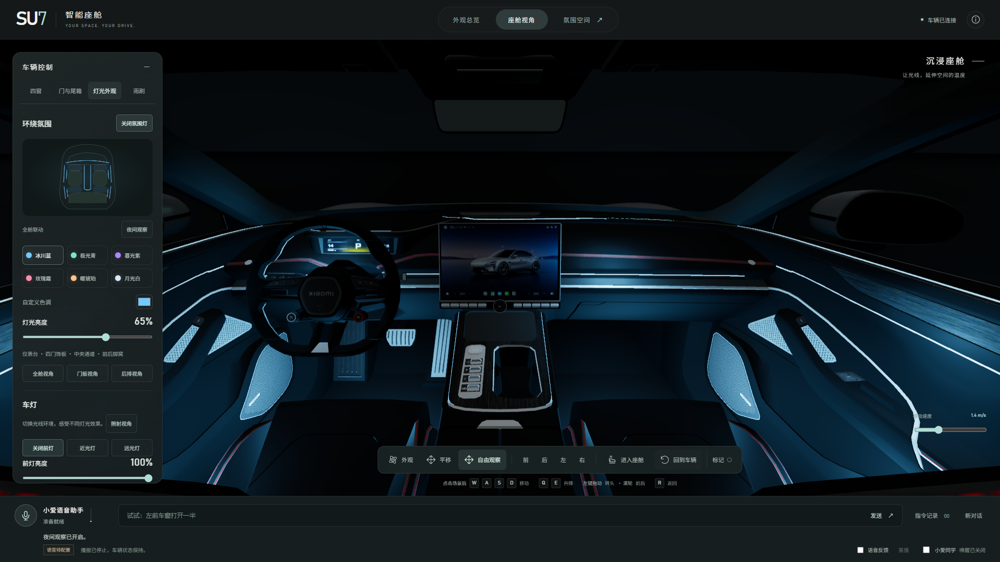
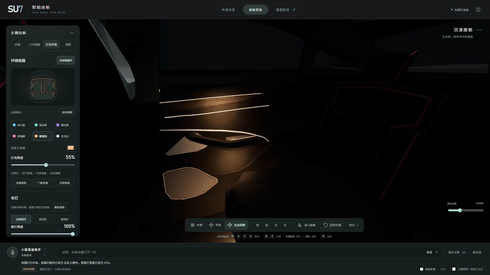

# SU7 智能座舱 · 0.7.1 收尾报告

2026-10-28。本轮按用户反馈独立设计氛围灯与控制界面，不使用 frontend-design 技能。基线为 `f74cbf1`，原 I7–I9 功能和分层验收记录继续保留。

## 氛围灯设计

采用环绕线条、局部轮廓和隐蔽补光三个层次。灯线随现有内饰结构走向，避免在玻璃、座椅或空中任意画发光管。

| 区域 | 本轮设计 |
|---|---|
| 仪表台 | 左右上沿补齐细窄灯线，与既有中控饰条形成前舱环绕 |
| 四门 | 新增四条上饰板灯线，保留扶手、把手附近灯面；每门增加收纳区柔光 |
| 扬声器 | 四门扬声器沿原装饰边界描边，强调局部材质 |
| 中央通道 | 中央扶手两侧增加轮廓灯线，与既有前段衔接 |
| 后排 | 后出风口控制台上沿灯线、两侧脚窝柔光 |

原有 12 个灯面扩展为 **25 个灯面**，8 个局部光源扩展为 **16 个**。门上灯面及每门两处补光跟随真实门机构运动。所有灯面和光源仍由统一氛围灯开关、颜色与亮度驱动，亮度为零时全部熄灭；没有增加一套独立于 LLM 的展示状态。

六种配色：冰川蓝、极光青、暮光紫、玫瑰霞、暖琥珀、月光白；每种配色通过已有开关／颜色／亮度命令批次执行。保留自定义颜色和 0–100% 亮度，支持已有语音相对调整。配色不会修改车漆。全舱、门板、后排三个视角可直接切换，夜间观察与柔光展厅使用同一车辆状态。

设计参考了 [BMW XM 官方内饰说明](https://www.press.bmwgroup.com/united-kingdom/article/detail/T0404093EN_GB/the-first-ever-bmw-xm) 对仪表台、门板、中控及脚窝环境光的分布，以及 [Polestar 4 官方内饰](https://www.polestar.com/en-ae/polestar-4/interior/) 对乘员周围光环境的处理。本方案是适配现有 SU7 展示资产的原创增补，不表示量产 SU7 原厂灯带配置。

## 界面收尾

使用石墨色背景、柔白文字与低饱和青色操作状态，减少大边框与常驻信息。主界面移除阶段编号、实验室标语、ASSET 卡、模型尺寸、版本、坐标和 FPS。顶部集中外观／座舱／氛围空间入口，底部保留小爱语音助手。四窗操作在 1920×1080 和 1366×768 下均可直接触达。

帮助入口保留操作说明、原作者 Mona x Supercars、来源链接、CC BY 4.0 许可及增强说明。**操作帮助 → 连接与诊断** 打开原诊断面板，保留自动路由／强制 LLM 验证、运行状态与 JSON 保存；没有删除排障能力。氛围空间默认隐藏模型标签，底部“标记”可恢复。语音助手、点击录音和“小爱同学”开关保留。

## 资产与回归

- 唯一工作工程：`assets/source/blender/su7-enhanced.blend`；运行文件：`assets/derived/su7-runtime.glb` 及前端副本。完整哈希见 [当前几何记录](assets/current-geometry.json)。
- 当前 153 节点、140 网格、102,731 三角面、46 材质、15 纹理；原基线全部 **140 个节点** 的几何与变换签名保持不变，仅增加 13 个灯面。
- 新灯面贴合原生内饰表面，最大顶点偏移约 0.60 mm；不跨越无支撑面片缺口。原门窗、原生前后备箱接缝、原生车灯、顶灯和雨刷均通过资产检查。
- `scripts/design-cabin-lighting.py --apply` 为本轮一次性增补，已烘焙；具有重复应用保护。后续正常导出仅运行 `npm run asset:export`，不得重跑早期导入或分件脚本。
- 类型检查、规范检查、生产构建通过；**99 项单元测试通过**。
- **42 项浏览器回归通过**，覆盖两个分辨率的实际 GLB、界面触达、相机、四窗、门控跟随、前备箱、原灯面、顶灯、雨刷、助手路由、亮度、配色与散射。未重复两分钟耐久测试；此前耐久记录仍属 0.7.0。
- 本轮截图及浏览器证据来自无凭据 3003 环境，属于实际渲染＋自动交互测试，不冒充真人或新增真实 API 验收。此前 I7–I9 真实 API 与真人记录保留，未因视觉更新重复标记。

证据：[几何检查](validation/final-polish/geometry.json)、[浏览器报告](validation/final-polish/playwright-results.json)、[单元报告](validation/final-polish/unit.json)。

本地演示：http://localhost:3000。交付包 `deliverables/SU7-0.7.1.zip` 包含源码、构建、Blender、GLB、纹理、来源与许可和验收资料；不包含密钥、`.env`、依赖目录或临时工具。安装及启动见 [README](../README.md)。原视频文件与时间偏移归档仍是上一轮的单独待办，不补造视频时间码；不增加用户已取消的距离／噪声测试。
