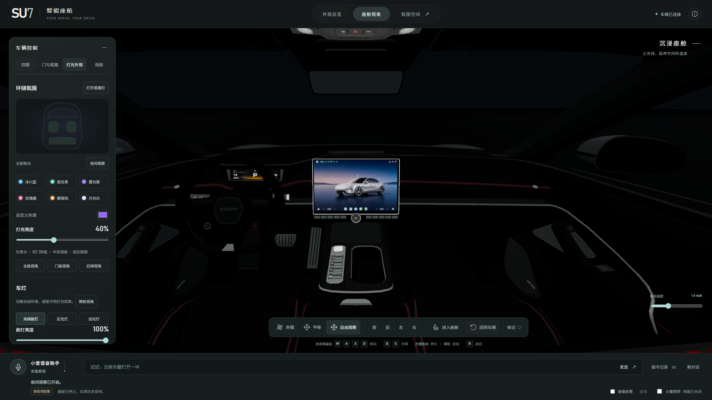
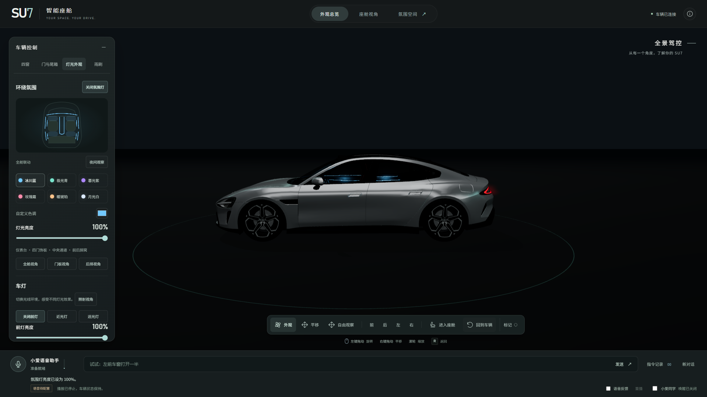
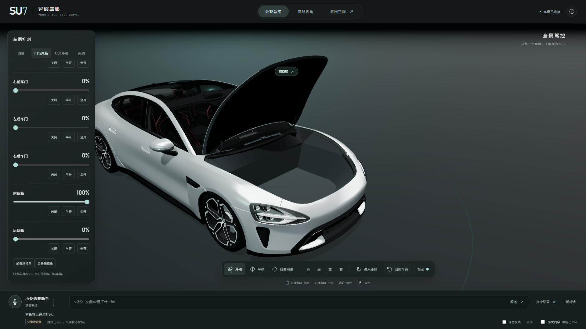
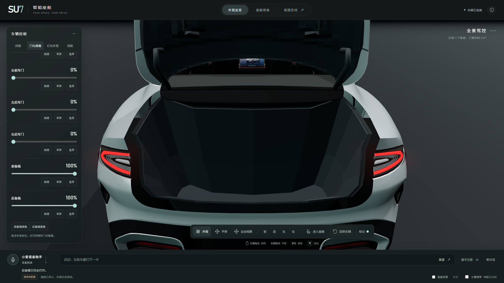

# 0.7.2 · 显示背光、底盘遮光与备箱内衬修正

2026-10-28，响应用户提供的四张截图；基线 `1b83988` / `v0.7.1-cabin-design`。

## 修正内容

1. **中控与仪表**：原显示区域和按键图案依赖环境光，夜间偏暗。仅为源模型 Mesh57 的显示／按键表面克隆材质，使用原有图集作为发光贴图；中控屏、仪表及按键背光在氛围灯关闭时仍保持清晰。没有让共用图集的其他饰板整体发光，也没有修改屏幕原图内容。
2. **氛围灯漏光**：四个前后脚窝点光源原来没有阴影，会照到车外地面。改为向下柔边聚光并开启真实阴影，在原底板下方、车身内部增加不透明底板背衬。其余灯带、门板光源仍跟随统一开关、颜色与亮度；关闭后不残留光照。没有按镜头位置隐藏灯光来掩盖问题。
3. **前备箱**：保留原生 82 点盖板接缝，轮拱附近的储物腔向内收窄，底部抬高，内侧后壁前移；内衬补为 12 mm 有厚度的封闭壁面。实际导出几何与左右轮胎／轮毂共六个网格的三角面相交检查均为零。
4. **后备箱**：缩短内腔，避免伸入后轮和后排区域，补 12 mm 壁厚。尾盖内衬从分离面片改为连续成形面，沿原盖板及灯壳内侧拟合，增加 136 段周边连接面；原外壳、灯组和徽标不改。新增“后备箱视角”便于查看开合效果。

当前 154 节点、141 网格、104,976 三角面、46 材质、15 纹理。原 153 个节点中，仅重做三个已有辅助内衬节点，其余 **150 个节点** 的几何、变换及材质归属保持一致；另增加一个底板背衬节点。完整哈希见 [当前资产记录](assets/current-geometry.json)。

修正已写入唯一 `assets/source/blender/su7-enhanced.blend` 和运行 GLB。一次性脚本 `scripts/repair-interior-enclosures.py` 具有重复应用保护；以后正常导出继续使用 `npm run asset:export`，不重跑早期导入或分件脚本。

## 验证与证据

- [实际 GLB 检查](validation/physical-fixes/enclosures.json)：150 个既有节点保持、两处内腔对 12 个车轮网格无相交、壁面封闭、四条脚窝光向下射线在车内底板被挡住。
- 原生前后盖检查继续验证原三角面／UV／法线、徽标运动及关闭状态外表面。修正中发现的尾盖内衬凸出均已修复，没有放宽外壳遮挡断言。
- [浏览器报告](validation/physical-fixes/playwright-results.json)：两个分辨率，实际 GLB 的闭合／半开／全开、夜间背光、灯光开关、底盘下方像素差分，以及相关门窗、顶灯、散射与相机回归。
- [单元报告](validation/physical-fixes/unit.json)、类型检查、规范检查、生产构建及完整资产导出检查。**28 项双分辨率浏览器回归及 99 项单元测试通过**，不将固定／自动输入标成真人验收。
- 本轮没有改动 LLM、ASR、TTS 或唤醒协议，既有真人与真实 API 记录保留，不重复声称新真人验收。

演示：http://localhost:3000。交付：`deliverables/SU7-0.7.2.zip`；包含当前 Blender／GLB、源码、构建及来源许可，不含本地密钥或 `.env`。
