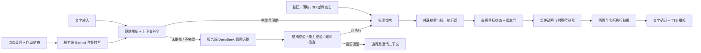
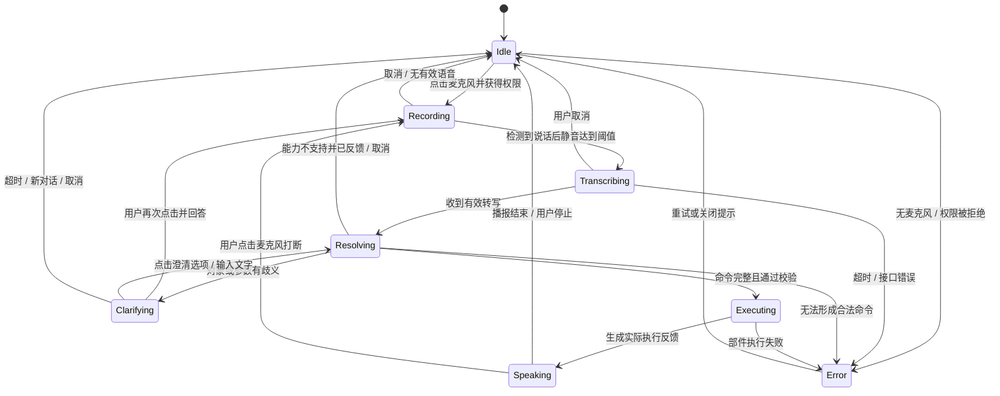

# 小米 SU7 3D 交互仿真 Demo：完整增量设计文档

版本：1.0 · 日期：2026-10-26（Asia/Shanghai）  
状态：设计基线，待实施。本文不代表代码、模型增强、API 接入或应用测试已完成。  
目标环境：本机 Windows + Chrome / Edge + 联网 API。  
配套文件：[增量执行与验收清单](./IMPLEMENTATION_CHECKLIST.md)。

> 实施状态更新（2026-10-26）：I0–I1 已完成本轮实施与实际验收，见 [验收报告](./I0_I1_VALIDATION.md)。本文保留制定设计基线时的环境／待办描述；下文“尚未下载／当前无代码”等为当时记录，最新执行状态以验收清单为准。完整 R01–R19 目标与后续增量范围保持不变。

## 1. 项目目标与范围

### 1.1 一句话目标

以指定的现成小米 SU7 车模为基座，增量构建一个可在浏览器运行的 3D 交互仿真 Demo：用户可自由观察车内外，通过手动操作和中文语音控制车辆部件，并获得画面、文字和语音反馈；完整保留 Vibe Coding 协作与验证过程。

### 1.2 已确认的需求基线

| 编号 | 已确认需求 | 最终交付判断 |
|---|---|---|
| R01 | 在用户这台 Windows 电脑的浏览器中运行 | 有可复现的本地启动方式 |
| R02 | 只使用小米 SU7，采用 Mona x Supercars 的指定免费模型 | 能识别为所选 SU7 基座，附来源与署名 |
| R03 | 允许拆分、补建、增强原车模 | 交付增强工程，并记录修改内容 |
| R04 | 自由拖动视角、旋转、平移、放大缩小，观察车内外 | 外观观察与车内自由观察均可操作 |
| R05 | 四个车窗独立控制 | 四窗分别支持开关、比例及相对调节 |
| R06 | 车门、车灯、后备箱 | 实际部件动画或光照效果与状态一致 |
| R07 | 车身换色 | 车漆实际改变，玻璃、轮胎、内饰不随之误变色 |
| R08 | 雨刷 | 支持启动、停止、档位，具有真实可见的往复动作 |
| R09 | 车内氛围灯 | 支持开关、颜色、亮度及相对调节，车内可见 |
| R10 | 上述控车能力均支持手动和语音 | 两种入口进入同一命令执行机制 |
| R11 | 中文语音，点击开始，说完自动结束 | 真实麦克风音频通过 API 转写 |
| R12 | Gemini 3.8 Flash 进行语音转文字 | 使用该模型的真实音频输入能力 |
| R13 | 简单意图走规则／正则，DeepSeek 兜底 | 可观察实际路由，具有两条真实执行路径 |
| R14 | 上下文对话、相对调节、多操作表达 | 正确解析指代，并在歧义时追问 |
| R15 | 画面 + 文字 + 语音反馈 | 反馈基于执行结果，失败不会播报成功 |
| R16 | 增量构建 | 每个可运行增量具有演示入口、验收记录和版本 |
| R17 | 可运行 Demo + 全过程录像 + 有价值的中间产物 | 交付包完整且能复现 |
| R18 | 技术使用主流稳定方案 | 不依赖实验性渲染或专有低普及框架 |
| R19 | 使用 `.blend` 进行模型加工与工程保存 | 保留增强后的 Blender 工程和运行用 GLB |

时间目标：没有硬性截止，争取当天完成尽可能完整的版本；全部已确认功能仍是最终验收范围。当天若仅完成部分增量，应准确标注进度，不能将中间版称为完整交付。

### 1.3 本次与后续扩展

本次实现车辆展示、部件动作、灯光材质和语音交互。驾驶、车辆动力学、交通场景、碰撞仿真不属于已确认范围。

“小爱同学”关键词唤醒是后续增量 I9；当前采用点击麦克风。唤醒词能力指本 Demo 的语音入口扩展，实际小米账号或设备生态接入需要另行确认。

本次以本地浏览器交付为目标。公网部署、手机完整适配、账号系统和多人同步不作为完成条件。

### 1.4 确认事项与设计默认值

需求表是用户已确认目标。以下是为了让实施可执行而提出的默认值，可在体验后调整：

| 事项 | 设计默认值 | 调整方式 |
|---|---|---|
| 用户语言 | 普通话中文为主 | 语音提示词和测试样本扩展 |
| 车窗相对调节 | 每次 10 个百分点 | 集中配置 |
| 车门／后备箱相对调节 | 每次 10 个百分点 | 集中配置 |
| 氛围灯相对亮度 | 每次 10 个百分点 | 集中配置 |
| 雨刷相对档位 | 每次一档 | 集中配置 |
| 模糊对象 | 先利用明确上下文；仍不唯一时追问 | 不默认操作全部车窗 |
| 上下文持久化 | 当前页面会话内保留，刷新清空 | 后续如有需要再持久化 |
| 初始状态 | 车窗／车门／后备箱关闭，灯和雨刷关闭 | 使用统一默认状态工厂 |
| 初始车漆 | 优先保留原模型外观 | 在模型审查后确定色板 |
| 反馈语音 | 清晰的普通话合成语音 | TTS 服务与音色待 API 接入时选择 |

## 2. 用户体验与页面设计

### 2.1 视觉方向

采用“精密汽车展厅”方向：大面积 3D 主视图、克制的深色工具面板、清晰的部件状态和适量青绿色强调。设计参考 `frontend-design` 与 `ui-ux-pro-max` 的交互及信息层级建议；技术实现遵循用户指定的桌面网页，不采用移动端原生框架。

- 3D 车辆占主导，控件不长期遮挡关键部件。
- 面板按“车窗／车门与后备箱／灯光／雨刷／车漆”分组，当前组展开。
- 使用统一 SVG 图标，配文字标签；正常、选中、禁用、失败状态明确。
- 主要文字、数值与背景具有足够对比度，保留键盘焦点。
- 中文使用思源黑体或 Noto Sans SC，英文标题可使用 Bahnschrift，数字可使用 JetBrains Mono；实施时检查可用性，额外字体本地存放并附许可。
- 背景建议 `#0B1014`，面板 `#141D23`，正文 `#EAF0F4`，强调 `#72DCCB`；最终以实际对比度检查调整。
- UI 微交互约 150–250ms；部件运动时间根据结构单独设置，支持动画中途改向。
- 提供“演示视图／调试记录”开关。正常操作界面显示用户关心的动作和反馈；路由、模型、耗时等诊断信息放在可折叠记录区。

### 2.2 页面结构

```text
┌─────────────────────────────────────────────────────────────┐
│ SU7 交互实验室        外观 / 自由观察 / 座舱      重置 / 帮助 │
├───────────────┬───────────────────────────────┬─────────────┤
│ 控车分组      │                               │ 对话与结果  │
│ 车窗          │        SU7 3D 主场景           │ 用户原话    │
│ 车门 / 尾箱   │     可点击部件与状态提示         │ 识别文本    │
│ 车灯 / 氛围灯 │                               │ 执行反馈    │
│ 雨刷 / 车漆   │                               │ 澄清选项    │
├───────────────┴───────────────────────────────┴─────────────┤
│ 点击麦克风说话  ● 录音状态 / 音量       文字输入 / 停止播报  │
└─────────────────────────────────────────────────────────────┘
```

桌面优先验收 1920×1080 和 1366×768。较窄窗口时把面板折叠为抽屉，保持 3D 区和语音入口可操作；不因此增加手机完整兼容要求。

### 2.3 镜头与部件点击

外观观察使用 OrbitControls：左键旋转、右键平移、滚轮缩放，并提供前／后／左／右／座舱快捷视角。其旋转、缩放和平移能力来自 [Three.js 官方 OrbitControls 文档](https://threejs.org/docs/pages/OrbitControls.html)。

自由观察模式增加相机朝向拖动与空间移动：鼠标拖动改变观察方向，WASD 或方向键移动、Q/E 升降、滚轮前后移动；输入框聚焦时不响应移动快捷键。该模式不是仅围绕车辆中心旋转，必须能够进入车内观察。采用可切换控制器，避免同时激活两个控制器抢占事件。

车内外移动不模拟人体碰撞；提供最小近裁剪距离、速度限制和“一键回到车辆”按钮，减少穿模迷失。车顶淡出或局部隐藏可作为观察辅助，需明确显示辅助状态，不能当成部件真实动作。

区分点击与拖动：按下至抬起移动超过约 5px 时只执行镜头拖动，不触发部件开关。实际车窗／门／尾箱可点击或选中后控制；细小雨刷、氛围灯允许使用锚定热点，同时保留面板操作入口。

### 2.4 典型闭环

1. 打开页面，看到 SU7 和操作提示。
2. 自由观察并选中左前车窗，用滑块设为 50%，车窗产生对应位移。
3. 点击麦克风，说“把左前车窗完全打开”，静音后自动提交。
4. 显示识别文字，规则命中，车窗运动；完成后文字与语音确认。
5. 再次点击麦克风，说“再关一点”，利用最近操作上下文调小开度。
6. 改为“帮我弄个蓝色的车内灯光，再把雨刷调快一档”，由 DeepSeek 补足复杂意图，校验后执行。
7. 若说“打开车窗”且没有明确对象，系统追问“需要打开哪一扇？”，不会擅自全开。

## 3. 主流技术方案

### 3.1 技术选型

| 层次 | 采用方案 | 用途与理由 |
|---|---|---|
| 前端语言 | TypeScript，严格类型检查 | 统一车辆状态、命令和 API 契约 |
| 前端 UI | React 稳定版 + React DOM | 标准组件化界面 |
| 构建 | Vite + npm | 本地开发、资源构建和锁定依赖 |
| 3D 渲染 | Three.js + WebGL | 加载车模、材质、灯光、动画和拾取 |
| React 3D 集成 | React Three Fiber + Drei 稳定版 | 用 React 组织场景与常用控制器 |
| 应用状态 | Zustand | 集中管理业务状态，避免把每帧动画写入 React |
| 数据校验 | Zod | 前后端共享命令与响应校验 |
| 后端 | Node.js + Express + TypeScript | API Key 管理、音频及意图服务适配 |
| HTTP | 标准 fetch + AbortController | 减少不必要 SDK，并支持超时／取消 |
| 音频采集 | getUserMedia + MediaRecorder + Web Audio | 录音、音量检测、自动结束 |
| 模型加工 | Blender，`.blend` 源工程 | 拆分、重建、轴心设置、导出 |
| 网页模型格式 | glTF 2.0 / GLB | 以 GLB 作为主要运行产物 |
| 逻辑测试 | Vitest | 意图解析、上下文、状态及边界测试 |
| 浏览器回归 | Playwright | 场景操作、录音流程模拟及界面回归 |
| 代码规范 | ESLint + TypeScript 检查 | 降低增量修改破坏既有功能的风险 |

实施时选择彼此兼容的稳定版本并提交 `package-lock.json`。目前官方明确 React Three Fiber 9 对应 React 19，10 仍是 alpha；因此推荐 React 19 + Fiber 9 的稳定组合，不追逐 alpha。依据：[React Three Fiber 官方说明](https://r3f.docs.pmnd.rs/getting-started/introduction)。Three.js、Drei 和 Vite 的具体版本在脚手架阶段结合 peer dependencies 锁定。

Express 使用稳定的 5.x 主线；它提供所需 HTTP 与中间件能力，见 [Express 官方文档](https://expressjs.com/)。不额外引入数据库、消息队列、Kubernetes、游戏引擎或复杂 Agent 编排。

### 3.2 环境基线

2026-10-26 已检查：Node.js 24.14.0、npm 11.9.0、Git 2.52.0、Python、VS Code、Chrome、Edge 和 NVIDIA RTX 5070 已存在。项目开始时为空目录。浏览器硬件加速、麦克风真实录音和 WebGL 稳定性仍需实测。

用户已在录屏，不安排安装录屏工具。未发现 Blender；需要进行模型加工时补充 Blender 稳定版。FFmpeg 不是初始依赖：若中转站音频格式不兼容，优先在浏览器编码 WAV，再判断是否确有必要增加转码工具。

### 3.3 应用运行方式

本地一个代码仓库，建议 npm workspaces 划分前端、服务端和共享领域包。开发时 Vite 将 `/api` 代理给 Express；交付构建后由 Express 同源提供前端静态资源和 API。

运行地址建议 `http://localhost:3000`，不以双击 `index.html` / `file://` 作为交付启动方式。浏览器麦克风需要安全上下文；localhost 是开发使用的受信任来源，远程访问需要另行配置 HTTPS。依据：[getUserMedia 文档](https://developer.mozilla.org/en-US/docs/Web/API/MediaDevices/getUserMedia)。

以下是未来实现应提供的脚本契约，当前尚无应用脚本：

```text
npm ci              安装锁定的依赖
npm run dev         同时启动网页和本地 API 服务
npm run typecheck   检查 TypeScript
npm run lint        代码规范检查
npm test            领域逻辑与协议测试
npm run test:e2e    浏览器回归
npm run build       构建交付资源
npm start           同源启动构建后的 Demo
```

### 3.4 架构与数据流



车辆业务状态以当前浏览器会话的 Store 为唯一事实来源。服务端处理转写、意图识别和语音合成，不单独维护第二份会自行变化的车辆状态。发送意图请求时携带车辆快照及 `stateRevision`；返回结果是命令提案，只有前端执行器校验通过后才能改变车辆。

共享领域包在浏览器校验全部入口，在服务端校验模型输出。规则解析可在浏览器完成，命中时不请求 DeepSeek；实际语音仍需 Gemini 转写，因此“规则免 LLM 意图调用”不等于整条语音链路免 API。

## 4. 模型资产：原始文件 → `.blend` → `.glb`

### 4.1 指定模型与已知信息

指定来源：[Xiaomi SU7 · Mona x Supercars](https://sketchfab.com/3d-models/xiaomi-su7-ca2cda599f5341068c992c9f44551bf9)。

2026-10-26 通过公开模型 API 复核：可下载，92,410 三角面，54,960 顶点，动画数量为 0，页面许可为 CC Attribution（CC BY 4.0）。这些信息说明模型可作为候选基座，不说明已分件或已具备可控制车窗。复核入口：[Sketchfab 模型元数据](https://api.sketchfab.com/v3/models/ca2cda599f5341068c992c9f44551bf9)。

当前尚未下载模型，也未检查实际文件格式、内饰、纹理、节点和车门／车窗分件。下载如需登录，使用平台正规下载入口；不从页面查看器提取未开放的模型文件。

交付附作者、模型链接、原始许可链接和修改说明。保留下载时的许可信息；若下载包附带不同条款，先记录差异再确认可用范围。模型来源说明与第三方字体、HDRI 等资源清单集中维护。

### 4.2 `.blend` 的使用方式

`.blend` 是模型增强的源工程，GLB 是网页运行资产，两者均交付。

1. 原始下载包只读保存，记录文件名、下载日期与哈希。
2. 如含 `.blend`，复制为工作工程后编辑；如只有 GLB、FBX 或 OBJ，导入 Blender 并新建增强工程。
3. 在 `su7-enhanced.blend` 内完成分件、模型修补、轴心、材质分组和辅助结构。
4. 导出 `su7-runtime.glb`，在真实网页里检查动作及材质；Blender 内正常不等于 GLB 网页正常。
5. 记录导出选项和资源映射，使原工程修改能够重复生成运行资产。

Blender 工程使用相对资源路径或打包必要纹理；在复制到独立交付目录后重新打开，确认没有依赖开发机上的绝对纹理路径。`.blend` 工程中可保留编辑辅助物体，导出时明确只导出运行需要的集合。

建议资产布局：

```text
assets/
  source/original/           原始下载包、来源与哈希
  source/blender/            su7-enhanced.blend
  source/textures/           可编辑纹理源文件
  derived/                  优化后的 GLB、纹理和导出报告
apps/web/public/models/     运行使用的 su7-runtime.glb
docs/assets/                模型审查、节点表、修改前后截图
```

glTF 导出只带出支持的几何、材质、层级和动画等数据；不能假定 Blender 的约束、驱动器、复杂节点会直接在浏览器运行。本方案主要由网页参数控制器驱动门窗和雨刷，避免依赖仅 Blender 生效的驱动表达式。导出依据：[Blender glTF 2.0 官方手册](https://docs.blender.org/manual/en/latest/addons/import_export/scene_gltf2.html)。

### 4.3 模型审查与增强清单

| 审查内容 | 检查项 | 缺失时的增强措施 |
|---|---|---|
| 基本方向与尺寸 | 坐标、比例、法线、包围盒 | 统一米制；Y 向上、车辆前向 -Z |
| 网格结构 | 独立物体、连通片、材质槽 | 以材质／连通片辅助拆分，必要时人工选面切分 |
| 四窗 | 是否独立，玻璃与框是否混合 | 从原网格分离或按开口重建玻璃；处理原玻璃避免重影 |
| 四门 | 门板、玻璃、内饰是否可独立 | 切分整套门结构，补内侧和门缝可见面，设置门铰链 |
| 后备箱 | 尾箱盖是否独立，打开后是否空洞 | 分离盖体，补可见内腔，设置旋转轴 |
| 雨刷 | 是否存在、是否可动 | 补建简化双雨刷及转轴，调整到前挡风玻璃附近 |
| 内饰 | 座椅、仪表台、门内侧是否可见 | 保留原有结构；缺失时补建满足近距离观察的简化内饰 |
| 氛围灯 | 是否已有灯带 | 增加仪表台／车门灯带，并配置克制的局部照明 |
| 车灯 | 灯罩／灯芯／车漆是否共享材质 | 拆分材质，灯芯发光与照明分别管理 |
| 车漆 | 车身材质与非车身材质是否混用 | 显式建立可换色材质白名单 |
| 透明资源 | 玻璃深度、遮挡、双面问题 | 从网页多角度复核透明排序和透射成本 |

不得仅把完整车身上的一块代理物体移动，就声称门或车窗已打开；原几何遮挡必须处理。允许使用补建部件，但需与原车模匹配并在修改记录中标明。

### 4.4 节点映射与层级

示意层级，不要求原模型本来具备这些名称：

```text
SU7_ROOT
  BODY_STATIC
  DOOR_FL_PIVOT
    DOOR_FL_MESH
    WINDOW_FL_ROOT
      WINDOW_FL_GLASS
  DOOR_FR_PIVOT / DOOR_RL_PIVOT / DOOR_RR_PIVOT
  TRUNK_PIVOT
  WIPER_L_PIVOT / WIPER_R_PIVOT
  LIGHTS_FRONT / LIGHTS_REAR
  AMBIENT_DASH / AMBIENT_DOORS
```

左／右均以坐在车内向车辆前方看为准。统一采用 `fl` 左前、`fr` 右前、`rl` 左后、`rr` 右后；此命名不随相机角度变化。

每个可动部件在映射文件中记录：节点、父节点、枢轴、局部运动轴、最小／最大值、材质角色、拾取代理。开度和具体位移／角度分离，模型更换轴心时不改语音规则。

门窗父子关系必须正确：车窗升降使用门的局部坐标，因此车门打开后，玻璃仍随门一起转动。

## 5. 统一状态、命令与动画

### 5.1 状态模型

```ts
type Corner = 'fl' | 'fr' | 'rl' | 'rr';
type WiperMode = 'off' | 'intermittent' | 'low' | 'high';

interface VehicleState {
  revision: number;
  windows: Record<Corner, { openness: number }>; // 0 关闭，1 全开
  doors: Record<Corner, { openness: number }>;
  trunk: { openness: number };
  lights: {
    headlights: 'off' | 'low' | 'high';
    turnSignal: 'off' | 'left' | 'right' | 'hazard';
  };
  ambient: { enabled: boolean; color: string; brightness: number };
  wipers: { mode: WiperMode };
  paint: { color: string };
}
```

本节是接口设计示意，不是已实现代码。数值域统一为 0–1；UI 和自然语言使用 0–100%。车辆目标状态、渲染中的当前姿态、相机状态、对话上下文分开存放。

相对操作以已接受的目标状态为基准。例如车窗正在向 50% 运动，收到“再开一点”时目标变为 60%，从当前可见位置连续运动过去。状态版本只在语义操作提交时增加，不在每一帧增加。

### 5.2 标准命令契约

```json
{
  "requestId": "local-unique-id",
  "baseRevision": 12,
  "origin": "voice",
  "route": "rules",
  "commands": [
    {
      "component": "window",
      "targets": ["fl"],
      "operation": "set",
      "property": "openness",
      "value": 0.5
    }
  ]
}
```

常规命令结构包括：`component`、明确的 `targets`、`operation`（set／adjust／query）、`property` 和类型明确的 `value`。不同部件和属性采用可判别的联合 Schema，不允许任意属性组合。另有 `trigger` 联合分支，仅供“一次刮刷”这类瞬时动作使用，携带白名单 `action`，不伪装成持久档位。

| component | 合法目标示例 | 属性或瞬时动作 |
|---|---|---|
| window / door | fl、fr、rl、rr | openness，0–1 |
| trunk | rear | openness，0–1 |
| headlights | front | mode，off／low／high |
| turnSignal | vehicle | mode，off／left／right／hazard |
| ambient | cabin | enabled、color、brightness |
| wiper | front | mode；或 trigger + action=swipe_once |
| paint | body | color |

群组目标如“全部车窗”在规范化时展开为明确列表，不允许模型生成任意目标字符串。query 返回真实目标状态及必要的当前动画状态，不修改车辆版本；可更新明确的对话焦点。

允许的目标由部件注册表提供；大模型不能生成任意 JavaScript、场景路径或网络请求。关闭／打开转换为明确目标值，避免重试时把同一个开关执行两次。手动 Toggle 在点击时转为 set 命令后执行。

### 5.3 执行与并发规则

1. 全量校验命令类型、目标存在、属性、取值范围及部件可用性。
2. 多命令先在状态副本上按语句顺序计算；全部有效才原子提交目标状态。同目标的多次相对调整按顺序计算。
3. 不同部件动画可同时播放；同一部件收到新目标时，从当前姿态改向，不排队播放过时动作。
4. 使用 requestId 去重。重复提交返回既有结果，不重复执行相对调整。
5. 记录 accepted、animating、completed、failed、cancelled、superseded 等生命周期。
6. 动画完成前可说“正在打开”；只有驱动器确认达到目标后才说“已打开”。部分驱动失败时分别记录结果，不伪装全部成功。
7. 异步意图请求返回时若 `baseRevision` 已过期，丢弃该提案并提示重试；不覆盖用户后续手动操作。
8. 手动拖动滑块即时显示预览，提交时才形成业务记录；拖动开始即使待处理的语音提案过期，避免松手前被旧语音覆盖。

### 5.4 部件控制规格

| 部件 | 手动入口 | 语音示例 | 实际表现 |
|---|---|---|---|
| 四窗 | 四窗独立滑块、全开／全关、玻璃拾取 | 左前窗开一半；右后窗再关一点 | 玻璃局部位移并藏入门板，0–100% 连续变化 |
| 四门 | 单门按钮及开度滑块、门体拾取 | 打开左前门；再开大一点 | 门围绕对应铰链旋转，玻璃与门内饰一起移动 |
| 后备箱 | 尾箱按钮／滑块、盖体拾取 | 打开后备箱；只开一半 | 尾箱盖围绕校准轴旋转，内侧可见 |
| 前灯 | 关闭／近光／远光 | 打开近光灯；切换远光 | 灯芯发光，地面或环境有可辨识照明差异 |
| 转向灯 | 左／右／双闪／关闭 | 打开双闪；关闭转向灯 | 左右灯按固定节律闪烁；不模拟驾驶联动 |
| 车漆 | 色板与颜色选择 | 车身换成蓝色 | 仅车漆白名单材质变色，保留明暗与反射 |
| 氛围灯 | 开关、色板、亮度滑块、灯带热点 | 氛围灯变蓝；再暗一点 | 车内灯带及附近表面出现颜色／强度变化 |
| 雨刷 | 关闭／间歇／低／高、一次刮刷按钮 | 打开雨刷；调二档；再快一点 | 双雨刷同步往复，档位改变频率，关闭后归位 |

前灯、转向灯的细分是满足“车灯控制”的设计默认范围。灯光模式互斥，双闪与单侧转向不同时激活。尾灯可随前灯显示对应亮度，刹车灯不增加驾驶逻辑。

雨刷默认档序：0 关闭、1 间歇、2 低速、3 高速；“打开雨刷”默认低速。语音“刮一下”对应独立瞬时动作：关闭状态下完整往复一次再归位，不改变持久档位；已连续运行时保持当前模式并反馈正在刮刷。瞬时动作同样使用 requestId 去重。雨滴／天气系统为可选视觉增强，不是雨刷功能验收的前提。

车门最大角度、尾箱最大角度和雨刷扫掠范围以模型拟合为准，并记录在校准文件中，不宣称与实车机械参数完全一致。

### 5.5 渲染约束

- 动画采用 delta time，避免帧率改变动作速度；门窗使用插值／阻尼，雨刷使用相位控制。
- 车窗采用真实位移与门板遮挡；如必须裁切，裁切平面随门局部坐标更新。
- 车漆、玻璃、轮胎、灯光材质分别克隆与引用，避免共享材质误改色。
- 氛围灯使用自发光灯带与少量局部光源；不能只改面板颜色。限制光源数量与过度泛光。
- 根据反射环境与光照设置展示车漆质感；避免仅增加灯强度掩盖错误材质。
- 视角自由移动时检查玻璃透明排序、车门内侧缺面和相机近裁剪。

## 6. 语音、规则、上下文与大模型

### 6.1 语音输入状态机



当前每一轮语音都要点击麦克风，包括澄清回答与上下文追问；不能因为“上下文对话”就自动开启持续监听。

建议录音默认：语音前等待上限 5 秒、检测到说话后的静音阈值 1.2 秒、单次最长 15 秒。噪声门限先校准，再用 Web Audio 音量／VAD 判断；RMS 简单检测不足时升级为更稳健的 VAD。阈值可配置，实测后调整。

用户可再次点击立即结束或取消。结束后释放麦克风 track，显示处理中。开始录音前停止当前 TTS，避免把系统播报录回。拒绝权限、无输入设备、空音频、环境持续噪声都有明确提示及重试入口。

### 6.2 Gemini 音频转写

指定模型为 `gemini-3.8-flash`。官方文档确认它支持音频输入、文本输出，但不支持音频生成或 Live API。因此采用短句录音提交方式，TTS 单独接入。依据：[Gemini 3.8 Flash 模型页](https://ai.google.dev/gemini-api/docs/models/gemini-3.8-flash)。

转写提示词仅要求忠实输出用户原话，保留方向、数量、否定词和程度，不把“转写”与“意图执行”混在一次调用。无法听清时标记不确定，不填补未说出的车型、部件或动作。

浏览器先用 `MediaRecorder.isTypeSupported()` 选择音频格式；通常优先 WebM/Opus，实际以浏览器和中转能力交集为准。Google 当前音频文档列出 WebM、WAV 等格式，但中转站可能只开放部分，需发送真实样本验证。[MediaRecorder 格式检测](https://developer.mozilla.org/en-US/docs/Web/API/MediaRecorder/isTypeSupported_static)、[Gemini 音频文档](https://ai.google.dev/gemini-api/docs/audio)。

如果中转不支持录制格式，优先使用 Web Audio / AudioWorklet 采集并编码 WAV，不假定改扩展名或 MIME 就完成转码。

### 6.3 规则／正则优先

规则处理流水线：

1. 规范化空格、常见标点、口语称呼、数字与百分比。
2. 优先识别否定、取消、查询和澄清回答，防止“不要打开雨刷”命中“打开雨刷”。
3. 识别部件、目标方向、动作、数值、档位、颜色与相对修饰。
4. 按完整句子进行多子句解析，保持动作顺序。
5. 用可信的对话上下文填补省略内容；仍有歧义则追问。
6. 只有全部可执行内容被完整覆盖时走规则执行；存在未知子句时整体交给大模型，不先执行半句话。

常见别名示例：主驾窗／驾驶位窗 → 左前窗，副驾窗 → 右前窗，尾箱 → 后备箱，车内灯带 → 氛围灯。方位固定为车辆自身，不随镜头改变。

“车窗开到 30%”表示开度 30%；“再开 10%”表示增加 10 个百分点；“升高一点”表示窗玻璃上升，即开度减少。颜色词映射到集中色板，具体 RGB 可微调。

规则不能用少量关键词直接猜测意图，需判断目标、否定、参数和整句覆盖率。测试必须包含“不要”“别”“先不要”和多子句中的局部否定。

### 6.4 上下文模型

```ts
interface DialogueContext {
  recentTurns: Array<{ role: 'user' | 'assistant'; text: string }>;
  lastFocus?: { component: string; targets: string[]; updatedAt: number };
  pendingClarification?: {
    partialIntent: unknown;
    missingSlots: string[];
    candidates: string[];
    expiresAt: number;
  };
}
```

默认保留最近 10 轮对话（最多 20 条用户／助手消息）和结构化最近操作；连续省略指代的焦点在 2 分钟无相关操作后失效，15 分钟无交互清空会话上下文。刷新、点击“新对话”或“重置全部”清空；单纯重置镜头不清空。

优先级：当前明确指令 > 当前澄清回答 > 最近明确操作对象 > 无法确定时追问。明确手动操作更新最近对象；仅镜头经过或悬停不改变指代。播报内容不能反向成为用户命令。

“打开车窗”无上下文时询问哪一扇；“打开所有车窗”才对四窗操作。“换成蓝色”在最近对象为车漆或氛围灯时可分别处理；对象不唯一时追问。

手动和语音共享真实状态。用户手动把氛围灯设为 40%，再说“亮一点”，应以 40% 为基准；模型不能用旧对话中的值覆盖最新状态。

### 6.5 DeepSeek 意图兜底

输入包含用户原话、近期对话、结构化焦点、车辆状态快照、支持能力表及待澄清槽位。输出仅允许三种结构：`execute`（标准命令列表）、`clarify`（待补槽位与短问题）、`unsupported`（原因和可执行建议）。

DeepSeek 具体模型 ID 在中转平台确定后配置，不把旧模型别名写死。官方模型列表可用于官方接入时核对；中转映射需独立验证。[DeepSeek 模型接口文档](https://api-docs.deepseek.com/api/list-models/)。

优先使用中转实际支持的 JSON 输出或结构化输出；即使返回合法 JSON，也必须再做 Zod 字段、枚举、取值与能力校验。官方 JSON Output 对空内容和 token 截断有注意事项，需覆盖测试；中转支持情况不可由官方能力直接推断。[DeepSeek JSON Output 文档](https://api-docs.deepseek.com/guides/json_mode/)。

模型返回“已经打开”不构成执行证据。执行成功反馈由标准化结果生成；无效 JSON 最多做一次受控修复，仍失败则不执行并提示重试。

模型的自报置信度不单独决定执行。目标缺失、相互冲突、超范围、未支持部件或语义仍有歧义时追问或拒绝，不能绕过校验。

### 6.6 语音反馈与打断

TTS 使用单独的 API Provider；服务商、模型与音色在中转接入时确认。不能把 Gemini 3.8 Flash 当成音频输出模型。

- 可执行前的回复：“正在打开左前车窗。”
- 完成后的回复：“左前车窗已打开到一半。”
- 澄清回复：“你要调整车身颜色，还是车内氛围灯？”
- 失败回复：“语音识别暂时不可用，请重试；也可以使用手动控制。”
- 多操作回复合并播报，避免每个细小动作都单独念一句。
- 滑块拖动中不连续播报，松手后可播报最终值；提供播报静音开关。
- 用户新录音优先，取消旧音频播放和未播放的旧回复。
- TTS 失败保留已完成动作与文字，不回滚车辆；显示播报失败，允许单独重播。

联调早期可显式使用浏览器语音作为临时反馈验证，但需标注该模式；最终 API 语音播报验收必须使用选定 TTS 接口，不静默替换。

### 6.7 对话验收示例

| 前序操作 / 状态 | 当前用户输入 | 预期 |
|---|---|---|
| 无上下文 | 打开左前车窗 | 规则执行，左前窗 100% |
| 左前窗 100% | 再关一点 | 左前窗 90%，其他窗不变 |
| 无上下文 | 打开车窗 | 追问具体哪扇 |
| 正在询问哪扇窗 | 左后那个，开一半 | 左后窗 50% |
| 氛围灯已开 | 换成蓝色，再暗一点 | 只改氛围灯颜色与亮度 |
| 最近操作为车漆 | 再换成红色 | 只改车漆 |
| 雨刷低速 | 再快一档 | 切换高速 |
| 无上下文 | 不要打开雨刷，把后备箱打开 | 雨刷状态不变，后备箱打开 |
| 无上下文 | 前面太暗了，帮我用近光照一下 | 规则未覆盖时 DeepSeek 解析为近光灯 |
| 车窗动画进行中 | 关回去 | 指向同一窗并连续反向，不瞬移 |
| 手动控制改变了状态 | 返回旧版本模型提案 | 提案过期，不覆盖新状态 |
| 无支持能力 | 把车开到楼下 | 说明当前能力并保持状态不变 |

## 7. API 接入与服务端契约

### 7.1 中转适配原则

用户倾向通过中转站接入，具体平台后续确认。当前设计不假定“支持 OpenAI 兼容文本接口”就同时支持 Gemini 音频输入、文件上传、结构化输出和 TTS。

服务端定义三个适配器：

```ts
interface AsrProvider {
  transcribe(audio: AudioInput, signal: AbortSignal): Promise<Transcript>;
}
interface IntentProvider {
  resolve(input: IntentInput, signal: AbortSignal): Promise<IntentResult>;
}
interface TtsProvider {
  synthesize(input: SpeechInput, signal: AbortSignal): Promise<AudioOutput>;
}
```

Google 原生协议与中转的兼容协议分别实现，不在业务层散布平台条件判断。Gemini 是多模态输入模型，不默认将它当作支持 `/audio/transcriptions` 的专用 ASR 接口。

中转能力探针分开验证：文本请求、Gemini 真实中文音频、DeepSeek JSON 输出、TTS 音频、错误码、超时和取消行为。`/models` 返回某模型名称也不代表其音频能力已验证。

### 7.2 本地 API

| 路径 | 请求要点 | 响应要点 |
|---|---|---|
| `GET /api/health` | 无密钥参数 | 服务状态、Provider 是否配置、能力探针状态；不返回密钥 |
| `POST /api/speech/transcribe` | multipart 音频、requestId、语言 | text、provider、model、durationMs、requestId |
| `POST /api/intents/resolve` | text、context、vehicleSnapshot、baseRevision、capabilities | execute／clarify／unsupported，命令提案和 requestId |
| `POST /api/speech/synthesize` | text、voice、requestId | 音频二进制及正确 Content-Type |

上述都是本地应用契约，与实际中转 API 路径解耦。规则解析命中时不调用意图接口；需要 DeepSeek 时才发送状态快照与上下文。

错误响应统一包含 `code`、面向用户的 `message`、`retryable`、`requestId`。至少区分：未配置、认证失败、模型不可用、音频格式不支持、限流、超时、空转写、无效模型输出、能力不支持。

建议单次音频限制 6MB、最长 15 秒；ASR 超时 20 秒、意图超时 15 秒、TTS 超时 10 秒。最多一次受控重试，仅针对适合重试的网络／限流错误；认证错误不重复请求。重试保持同一语义 requestId，并避免重复执行和重复播报。

### 7.3 API 配置与密钥

建议服务端配置名，实际环境文件在实施阶段再创建：

```text
ASR_BASE_URL
ASR_API_KEY
ASR_MODEL=gemini-3.8-flash
ASR_PROTOCOL
INTENT_BASE_URL
INTENT_API_KEY
INTENT_MODEL
INTENT_PROTOCOL
TTS_BASE_URL
TTS_API_KEY
TTS_MODEL
TTS_VOICE
TTS_PROTOCOL
```

API Key 仅由本地服务端读取，不写入前端源码、浏览器持久存储或 `VITE_*` 变量。环境文件加入忽略规则，示例配置只保留空值／说明。配置成功检查只报告是否配置及探针结果，不打印密钥。

用户已经在录屏，输入与配置凭据时避免出现在终端输出、浏览器地址、请求日志和录制画面中。记录模型名称、路由、耗时及错误类型即可。

音频默认只为本次请求临时使用，不自动保存原始语音。用于交付的固定测试音频与日常录音分开，若需要保存测试录音，再明确保存目录和用途。

### 7.4 未配置和故障时的表现

手动操作、相机和本地文字规则可正常使用。依赖服务不可用时，明确显示“语音服务未配置／暂不可用”，不要显示成功或使用预写结果冒充真实模型响应。

Mock 音频和意图适配器可用于自动化测试，但与真实 API 模式分开标记。完整交付必须通过真实麦克风、Gemini、DeepSeek 和 TTS 验收；仅手动版或 Mock 版均属于中间增量。

## 8. 增量路线与阶段验收

### 8.1 增量总览

阶段完成的共同条件：本轮演示可运行、核心验收通过、此前相关功能没有回归、阶段证据保存，并保留可回退版本。I0 是准备与可行性验证阶段，从 I1 起每个增量必须可运行。

| 增量 | 版本目标 | 新增能力 | 必看演示 | 主要依赖 |
|---|---|---|---|---|
| I0 | 准备基线 | 模型审查、资产工程、环境与接口探针计划 | 真实模型结构与缺口说明 | 正规模型下载 |
| I1 | 可观察 SU7 | 场景、材质、车内外自由镜头 | 自由旋转、移动、缩放并返回车辆 | 可加载 GLB |
| I2 | 第一个可控部件 | 四窗、统一状态与命令、文字规则 | 左前窗 50%，其余窗分别操作 | 车窗分件与校准 |
| I3 | 第一条真实语音闭环 | 点击录音、Gemini、基础语音反馈 | 对车窗说话并真实执行 | ASR／TTS 可用配置 |
| I4 | 机械部件扩展 | 四门、后备箱 | 门打开时再调玻璃、尾箱半开 | 门／尾箱增强资产 |
| I5 | 光照与外观 | 前灯、转向灯、车漆、氛围灯 | 进入车内看灯带颜色与亮度变化 | 材质与灯光分组 |
| I6 | 雨刷控制 | 间歇／低／高、归位、一次刮刷 | 语音调档、手动停止归位 | 雨刷几何与轴心 |
| I7 | 上下文与模型兜底 | DeepSeek、多操作、澄清、相对调整 | 规则和模型两条路由 + 连续省略指代 | 全能力注册表、DeepSeek 配置 |
| I8 | 完整交付 | 回归、性能、启动说明、证据归档 | 从干净依赖安装到完整验收演示 | 全功能和真实 API |
| I9 | 后续扩展 | “小爱同学”唤醒 | 唤醒后进入单轮语音流程 | 另行选择唤醒引擎 |

主依赖：`I0 → I1 → I2 → I3 → I4 → I5 → I6 → I7 → I8`。若 API 尚未提供，可先完成 I4–I6 的手动与文字路径，再补齐 I3 和 I7；此时 I3 不能记为完成，最终验收不能跳过。

I3 的基础上下文只处理必要的当前对象和澄清；I7 扩展为完整的跨入口、多轮、复杂表达能力。各部件在加入时即注册手动和规则能力，后续语音复用同一注册表。

### 8.2 I0：环境、模型与可行性基线

**目标**：识别真正需要的资产加工，避免开发到一半才发现车窗不可分或中转不支持音频。

任务：

- 正规下载指定模型，保存作者、许可、文件哈希和原始包。
- 检查浏览器 WebGL、音频输入设备和麦克风权限。
- 准备 Blender 工程，导出节点清单、材质清单、内饰截图和部件缺口表。
- 形成车窗、门、尾箱、雨刷、灯带的增强顺序，不因原模型缺失直接换掉已选模型。
- 记录 Provider 配置待办；有凭据后做每项最小探针，无凭据时保留为未验证。

退出条件：模型来源与缺口明确；能够确定 I1/I2 的资产路径。需要登录或模型文件无法获取时准确记录，不用搜索截图代替模型。

证据：`asset-audit.md`、来源清单、原始／增强对比图、接口能力表。后续复用原始文件，不在每轮重新下载。

### 8.3 I1：可观察的 SU7

**目标**：先让真实选定车模在浏览器中稳定呈现。

任务：建立主流前后端骨架、锁定依赖、加载 GLB、环境光照、加载进度、模型错误提示、外观观察和自由相机、座舱定位与视角重置。

验收：

- 使用实际 SU7 GLB，材质、轮胎、玻璃和朝向合理。
- 能旋转、平移、缩放、进入车内观察并返回；没有镜头输入冲突。
- 连续操作相机 2 分钟无错误；在录屏状态记录帧率基线。
- 模型加载失败有错误和重试，不能无限加载。

本轮不以可点击按钮的外观冒充部件控制。证据为场景截图、相机演示、实际资源信息和性能基线。

### 8.4 I2：四窗 + 统一控制领域

**目标**：建立后续所有部件复用的状态和执行机制。

任务：增强四窗，创建部件映射、标准命令、校验器、执行器、动画驱动、四窗面板、玻璃点击／选中、文字输入和车窗规则。

验收：

- 四窗分别在 0／50／100% 下呈现正确位置，其他窗不被误动。
- “左前窗开一半”和滑块 50% 生成等价目标状态。
- 玻璃确实露出开口，不能仅改透明度或缩放完整车窗冒充下降。
- 连续开／关时可中断、改向；拖动镜头不误操作车窗。
- 100% 再开、0% 再关保持边界，文字说明到达极限。

证据：四窗位置对比、规则测试结果、命令记录和最小演示。此阶段已有手动＋文字闭环，尚不称为语音版。

### 8.5 I3：真实语音控制车窗

**目标**：尽早完成“真实说话 → API 转写 → 规则 → 动作 → 语音反馈”。

任务：录音 UI、自动结束、Gemini 适配、转写展示、规则路由、TTS 接口、播报打断、权限和接口故障恢复。

验收：

- 使用真实麦克风说“左前车窗开一半”，能转写并执行，语音确认最终值。
- 结束录音后麦克风释放；没有静音音频误操作。
- 规则路径无需请求 DeepSeek；诊断记录反映真实路径。
- 开始新录音立即停止旧播报，录音不把系统声音再次执行。
- 无权限、断网、无 Key、音频不兼容分别显示正确原因。

如暂用浏览器 TTS 调试，标记“临时反馈”，并保留 API TTS 未通过项；不能据此完成最终 R15。

### 8.6 I4：四门与后备箱

**目标**：扩展机械部件，并验证层级关系。

任务：门／尾箱拆分补建、铰链校准、内侧补面、按钮和开度滑块、3D 拾取、规则和语音能力注册。

验收：四门可独立开启并调开度；车门开启时再升降该门车窗，局部坐标正确；后备箱可半开和全开；关键观察角度没有明显残留原几何或巨大空洞。手动与语音均能执行。

证据：门窗联动、尾箱开度演示与模型修改记录。需要补建的内侧明确记为增强内容，不声称完整还原实车工程结构。

### 8.7 I5：车灯、氛围灯和车漆

**目标**：让材质／灯光成为真实视觉交互。

任务：车漆白名单、前灯与转向模式、灯芯材质、少量动态光源、内饰灯带、颜色和亮度控件、相应规则与语音命令。

验收：

- 车漆切换至少 5 个预设颜色，玻璃、轮胎、内饰不误变色。
- 近光／远光有可辨差别，双闪与单侧转向符合模式约束。
- 从车内可看到灯带，亮度 0／50／100% 有变化；关闭后不残留发光。
- 手动与语音都可改变颜色、亮度和开关，不依赖更改 UI 标签制造效果。

证据：相同相机位置的前后对比、座舱氛围灯演示、材质角色清单。

### 8.8 I6：雨刷

**目标**：加入可持续运行、可调档、可正确停止的机构动画。

任务：双雨刷几何与扫掠校准、相位动画、间歇／低／高模式、一次刮刷、语音档位与相对调整、关闭归位。

验收：在外观与座舱视角均可辨识动作；三档速度有明显差异；“再快一点”不会超过最高档；关闭后完成必要回程并停在归位点；动画期间门窗、镜头和其他 UI 保持可用。

证据：同视角档位对比和停止归位录制。雨刷部件与前挡风玻璃不出现明显穿插，范围以 Demo 视觉合理为标准。

### 8.9 I7：上下文、DeepSeek 与复合指令

**目标**：完成自然语言协作，而不是只识别固定口令。

任务：完整上下文管理、澄清槽位、DeepSeek 结构化输出、语义与能力校验、多命令事务、版本检查、规则整句覆盖、跨手动和语音的焦点更新。

验收：

- “开氛围灯 → 换蓝色 → 再暗一点”正确控制同一对象。
- 切换到车漆后再说“变红”只改变车漆；无焦点时追问。
- 使用规则未覆盖的自然表达，真实调用 DeepSeek 并执行。
- 一句话中门窗、灯光和雨刷多个操作可正确解析并执行。
- 包含否定／未知子句的复杂句不会被规则截取后误执行。
- 旧模型回复、重复请求、非法 JSON、超范围参数均不会破坏状态。
- 真正需要澄清的场景通过语音和文字追问，回答后补全原意图。

证据：规则与 LLM 分别命中的实录、上下文样例、模型输出校验结果和负例回归。

### 8.10 I8：完整交付与回归

**目标**：让另一位按说明操作的人能够在约定环境复现。

任务：性能调优、完整验收、安装／启动说明、模型源工程整理、第三方资源清单、版本与录像时间索引、可选精简展示视频。

退出条件：需求 R01–R19 逐项有证据；核心失败路径已验证；真实 API 模式通过；完整录像和 Demo 资源齐全；没有以占位按钮、Mock 响应或临时语音替代最终要求。

### 8.11 I9：后续“小爱同学”唤醒

独立扩展唤醒入口，不重写控车领域、ASR 或上下文。检测到唤醒词后触发现有单轮录音流程，继续沿用“说完自动结束”。

另行选择关键词唤醒引擎与部署方式，验证中文关键词、误唤醒、浏览器权限和持续采集成本。不能假定当前 Gemini 3.8 Flash 支持实时唤醒；也不以系统播报触发自身唤醒。I9 不计入本次完成条件。

### 8.12 当天推进安排与估时

| 工作包 | 粗估有效工作量 | 风险 |
|---|---|---|
| I0–I1 资产审查与场景 | 1–2 小时 | 下载登录、格式、材质、缺失内饰 |
| I2 四窗与控制领域 | 1–2 小时 | 原网格焊接、玻璃分离、门板遮挡 |
| I3 语音与基础播报 | 1–2 小时 | 中转音频能力、Key、TTS、网络 |
| I4 门与尾箱 | 1–3 小时 | 分件、铰链、内侧补建 |
| I5–I6 灯光／车漆／雨刷 | 1.5–3 小时 | 材质分组和雨刷拟合 |
| I7 上下文与模型兜底 | 1–2 小时 | 输出协议、歧义、并发与负例 |
| I8 回归与交付 | 1–2 小时 | 性能与复现问题 |

合计约 7.5–16 小时仅作为规划区间，不是当天完成承诺；复杂重建和等待接口不包含在该区间内。I0 结束后按真实模型结构修订估时。保持完整范围，以已通过的增量作为当天可展示成果，不在时间不足时悄悄删掉已确认功能。

## 9. 测试、性能与完成标准

### 9.1 测试分层

| 层次 | 工具／方式 | 验证重点 |
|---|---|---|
| 领域测试 | Vitest | 状态边界、同目标顺序、多命令原子校验、去重、过期版本 |
| 规则与上下文 | 表驱动样例 | 方向、数字、否定、省略、焦点变化、追问补全 |
| Provider 协议 | 固定响应样本 + 真实小样本 | 音频格式、空内容、错误映射、超时和 JSON 校验 |
| 浏览器交互 | Playwright | 手动控制、拖动误触、面板、状态回显、错误恢复 |
| 模型视觉 | 人工多角度检查 + 固定截图 | 真实开口、铰链、内饰、透明玻璃、灯光、雨刷归位 |
| 真实语音 | 用户麦克风 + 真实 API | 中文转写、自然指令、上下文、播报打断 |

不为纯视觉样式写机械单测，不把大量快照当作部件物理正确的证据。3D 截图只能提供视觉参考，关键几何动作需实际观察。

### 9.2 关键验收用例

| ID | 操作 | 通过条件 |
|---|---|---|
| A01 | 安装锁定依赖、构建并启动 | 浏览器可打开，说明与实际一致 |
| A02 | 旋转／平移／缩放／自由移动／进入车内 | 可完成，能一键返回，拖动不误开部件 |
| A03 | 四窗各测 0／50／100% | 各自独立，开口真实，方向正确 |
| A04 | 门打开后操作对应车窗 | 玻璃随门运动且正常升降 |
| A05 | 四门和尾箱开关／半开 | 轴心和内侧合理，状态与动画一致 |
| A06 | 近光／远光／转向／双闪 | 模式正确，画面有真实变化 |
| A07 | 切换车漆 | 只改车漆白名单，不污染其他材质 |
| A08 | 氛围灯开关、颜色、亮度及相对调整 | 座舱可见，数值和画面一致 |
| A09 | 雨刷三档、一次刮刷、停止 | 档位可辨，停止归位，其他交互可用 |
| A10 | 所有部件使用字面语音命令 | 实际麦克风 → Gemini → 规则 → 执行 |
| A11 | 使用未被规则覆盖的自然表达 | 实际 DeepSeek 响应经校验并执行 |
| A12 | 连续说“换蓝色／再暗一点” | 使用正确最近对象和最新状态 |
| A13 | 无对象说“打开车窗”再回答 | 先追问，补全后执行，不擅自全开 |
| A14 | “不要打开雨刷，把尾箱打开” | 否定正确，尾箱动作正确 |
| A15 | 同句控制多个部件 | 全句解析后提交，不先执行半句话 |
| A16 | 连续操作、重复请求、旧模型回复 | 无重复相对调整和旧状态覆盖 |
| A17 | 无权限、断网、401、429、超时、无效 JSON | 提示明确，不误操作，不播报成功 |
| A18 | 播报中点击录音 | 旧播报停止，不录入自身反馈 |
| A19 | 语音合成失败 | 动作及文字保留，播报可独立重试 |
| A20 | 构建产物、源模型、许可与录像检查 | 资源可追溯，接口凭据未进入交付包 |

固定规则／领域验收集要求全部通过，避免同一字面命令随机改变路由。自然语音与模型样例记录实际成功数、总数、网络条件和失败原因；目标为至少 90% 的预定自然表达样例成功且核心路径零误操作，不能用该小样本宣称普遍准确率。

每种部件至少覆盖手动和真实语音各一次；比例部件另测边界与中间值。规则优先可以覆盖大部分动作，但必须另有真实 DeepSeek 兜底成功样例。

### 9.3 性能目标

以下是拟定的工程目标，需要在用户机器、目标分辨率和录屏同时开启时测量，不是已测结果：

| 指标 | 目标 |
|---|---|
| 手动操作可见反馈 | 一般在 100ms 内开始响应 |
| 1080p 场景流畅度 | 常规操作尽量 60 FPS；代表性操作避免持续低于 30 FPS |
| 本地文字规则解析 | 一般 50ms 内完成 |
| 本地资源冷启动首个可交互场景 | 目标 5 秒内，记录硬件和资源大小 |
| 静音判定结束到语音规则动作开始 | 目标 p50 ≤ 4 秒、p95 ≤ 10 秒 |
| 加 DeepSeek 的语音动作开始 | 目标 p50 ≤ 7 秒、p95 ≤ 15 秒 |
| 持续稳定性 | 10 分钟综合操作无崩溃、严重卡死或状态串扰 |

语音延迟目标受中转和网络影响，真实测量后给出结论。TTS 音频生成时间单独记录，不能把用户说话时长和静音阈值混入模型响应耗时。

优化顺序：修复异常重渲染与资源泄漏 → 限制 devicePixelRatio（建议上限 1.5–2）→ 减少实时阴影和光源 → 压缩纹理与模型 → 选择性开启后处理。静态时可按需渲染，雨刷／闪灯／动画时维持帧循环。纹理与几何卸载应 dispose，切换视角不重载整个 GLB。

初始资源预算建议：运行模型及必要纹理尽量不超过 50MB、主要纹理不超过 2K、常规视角 draw calls 尽量不超过 200。它们是优化起点，I0 审查后按画质与实际帧率调整，不能为了满足数字删除已确认的可操作部件。

### 9.4 执行轨迹与耗时记录

每个交互记录 requestId、输入来源（manual／text／voice）、实际意图路由（manual／rules／llm）、转写文本、标准命令、baseRevision、提交后版本、执行状态和时间戳。手动和文字路径没有 ASR 耗时，规则路径没有意图模型耗时，对应字段应缺省或标记不适用，不能填造数据。

语音分别记录录音结束、转写完成、意图完成、动作开始、动作完成和播报开始时间。可导出脱敏 JSON 用于阶段验收；不导出请求认证头、密钥、原始音频或模型内部推理。

## 10. 工程结构与可复现交付

建议布局，实际文件随增量产生，不提前创建无内容占位工程：

```text
apps/
  web/src/
    scene/                场景、相机、材质、拾取
    vehicle/              部件注册、映射、动画驱动
    controls/             控车面板和热点
    voice/                录音、VAD、播放、语音状态机
    dialogue/             会话与澄清界面
    state/                车辆目标状态与 UI 状态
  web/public/models/      su7-runtime.glb
  server/src/
    routes/               本地 API
    providers/            Gemini、DeepSeek、中转、TTS
    config/               服务端配置与能力检测
packages/
  domain/src/             命令 Schema、执行规则、规则解析、上下文契约
assets/source/            原始模型、Blender 工程、纹理源
assets/derived/           导出与优化资产
tests/                    领域、协议、浏览器和验收样例
docs/                     设计、决策、资产、测试与运行说明
evidence/                 阶段截图、脱敏事件、录像时间索引
```

最终交付至少包含：

1. 完整源码、依赖锁文件、构建产物和本地启动脚本。
2. `README`：环境、安装、配置、启动、操作方式、故障处理。
3. 原始模型来源信息、增强 `.blend`、运行 `.glb`、必要纹理和导出说明。
4. 第三方资源署名与许可清单，不包含用户 API Key。
5. 本设计文档、增量清单、资产审查、关键决策、验收报告和已知限制。
6. 用户已录制的完整过程视频及对应时间索引；可另附 3–5 分钟精简演示。
7. 能说明 AI 协作价值的提示词、修改反馈、失败修正和阶段版本记录。

完整过程视频可放在独立交付目录，索引记录实际路径；不要求把大型原始视频提交进 Git。若发布 `.blend`／GLB 到远程仓库，先核对资源许可与托管大小；本地交付不依赖远程仓库。

## 11. Vibe Coding、录制与考核证据

### 11.1 每轮协作流程

1. 明确本轮增量、现有基线和可观察验收点。
2. 给 AI 提供相关需求、资产节点和现有状态接口，要求只完成本轮范围。
3. AI 生成代码／模型处理脚本／测试；人检查真实画面、动作和交互感觉。
4. 把可观察问题反馈给 AI，例如“左前门开时玻璃留在原地”，避免只说“效果不好”。
5. 修正后运行针对性验证，检查相邻已有功能。
6. 保存阶段结果、真实问题与修复说明、录像时间标记；有 Git 后形成对应提交。

示例增量提示词：

> 阅读设计文档和当前部件映射，只实施 I2。复用统一命令与状态，完成四窗独立开度、文字规则和玻璃动画。不要增加后续功能。完成后说明如何验证 0／50／100%、动画改向和拖动误触，并实际执行可运行的检查。

示例视觉修正反馈：

> 左前门开启后，该门车窗下降方向变成了世界竖直方向。请检查父子层级和局部坐标，修复后分别验证车门关闭、半开和全开时的车窗升降，并保存同视角对比。

### 11.2 考核维度映射

| 考核维度 | 展示内容 | 可交付证据 |
|---|---|---|
| AI 工具使用程度 | 编程、技能检索、模型处理脚本、调试和验证 | 工具使用记录、代码差异、模型增强记录 |
| AI 交互协同程度 | 人提出验收／反馈，AI 修正，真实复测 | 对话与录像片段、问题闭环、增量版本 |
| AI 需求理解程度 | 已确认目标 → 能力 → 命令 → 实际动作 | R 编号与验收用例映射、歧义追问和上下文演示 |

AI 使用程度按真实任务和产物说明，不虚构生成比例或未使用工具。模型诊断展示原话、转写、规则／LLM 路由、标准命令、最终状态与耗时；不展示或要求大模型内部思维链。

### 11.3 录像时间索引

用户已在录屏，后续只增加标记和整理，不重复安装录屏工具。保留完整原始过程，允许分段文件但按时间排序。

```text
实际录像时间 | 增量 | 本轮目标 | 人的反馈 | AI 的修改 | 复测结果 | 提交/资产版本
```

每个增量建议保留：本轮开始说明、第一次运行、一个有价值的问题与修正、通过验收的演示。没有发生的问题不为视频效果人为制造。

### 11.4 最终演示顺序

1. 展示车型、来源与自由视角，进入车内再返回。
2. 手动四窗、车门和后备箱，展示门窗层级关系。
3. 演示车漆、灯光、氛围灯和雨刷档位／归位。
4. 真实语音字面指令，展示规则路径。
5. 自然表达和复合命令，展示 DeepSeek 路径。
6. “开氛围灯 → 换蓝色 → 再暗一点”，展示上下文。
7. 无目标车窗指令触发澄清，再回答补全。
8. 展示一个真实错误恢复案例、测试报告和增量版本。

## 12. Skills 与 MCP 使用计划

### 12.1 Skills

已实际使用 `find-skills` 搜索并筛选以下候选；截至当前未安装新增技能。

| 技能 | 计划用途 | 当前状态 |
|---|---|---|
| `find-skills` | 查找与核验任务技能 | 已使用 |
| `frontend-design` | 车模中心界面、视觉风格和交互实现 | 已存在，本次设计参考 |
| `ui-ux-pro-max` | 信息层级、控件、反馈和可访问性 | 已存在，本次已运行设计建议查询 |
| `threejs-interaction` | 相机、拾取、拖动与点击区分 | 待按需安装 |
| `threejs-animation` | 机构运动、动画改向与组合 | 待按需安装 |
| `threejs-loaders` | GLB、纹理与加载排错 | 待按需安装 |
| `playwright-cli` | 浏览器验证和问题复现 | 待按需安装 |

前三个 Three.js 专项技能来自社区项目 [cloudai-x/threejs-skills](https://github.com/cloudai-x/threejs-skills)，已核验内容与仓库元数据；浏览器专项来自微软 [microsoft/playwright-cli](https://github.com/microsoft/playwright-cli)。安装量分别可在 [交互技能](https://skills.sh/cloudai-x/threejs-skills/threejs-interaction)、[动画技能](https://skills.sh/cloudai-x/threejs-skills/threejs-animation)、[加载技能](https://skills.sh/cloudai-x/threejs-skills/threejs-loaders)、[浏览器技能](https://skills.sh/microsoft/playwright-cli/playwright-cli) 查看；安装量只用于初筛，不作为能力保证。

实施时如有必要再执行：

```powershell
npx skills add cloudai-x/threejs-skills@threejs-interaction
npx skills add cloudai-x/threejs-skills@threejs-animation
npx skills add cloudai-x/threejs-skills@threejs-loaders
npx skills add microsoft/playwright-cli@playwright-cli
```

### 12.2 MCP 与本地工具

| 能力 | 建议 |
|---|---|
| 文件／终端／Git | 当前工具足够，无需额外连接 |
| 浏览器操作 | 先验证已有浏览器工具；自动化回归可直接使用 Playwright |
| Playwright MCP | 可选增强，不是完成 Demo 的必要前置条件 |
| Blender 自动处理 | 优先 Blender Python／命令行，必要时再评估 Blender MCP |
| GitHub | 远程版本协作可选，本地版本不依赖连接 |
| ASR／意图／TTS | 应用自身调用 API，不通过开发用 MCP 代替 |

本次插件目录检索未返回 Blender／Playwright 匹配插件，不代表无法通过本地方式安装 MCP。依据：[微软 Playwright MCP](https://github.com/microsoft/playwright-mcp)。不要为了展示工具数量添加无实际用途的连接。

## 13. 风险、待确认事项与处理

| 风险／待确认项 | 影响 | 处理及完成判断 |
|---|---|---|
| 正规模型下载需要登录 | I0 资产获取 | 用户通过平台完成登录／下载，保留来源 |
| 车窗／门与车身焊接 | I2／I4 加工量增大 | Blender 拆分或补建，记录改动；不改成其他车型 |
| 内饰不完整 | 车内观察质量 | 补建可观察范围；记录简化之处 |
| Blender 材质与 GLB 不一致 | 网页外观与工程不一致 | 导出后网页实测，采用可导出的 PBR 表达 |
| 中转只支持文本、不支持音频 | 指定 Gemini ASR 无法接入 | 用真实样本探测，选择支持音频的接入方式；不静默换模型 |
| DeepSeek 型号别名与平台不一致 | 意图调用失败 | 以平台实际模型列表和测试确认，配置化处理 |
| TTS 服务未选定 | R15 尚不能全部验收 | 选择可用 API，验证中文、格式、延迟和打断 |
| 录音误断句或持续噪声 | 指令截断／无法结束 | 调 VAD 阈值，保留手动结束与重试 |
| 玻璃透明排序／穿插 | 视觉质量 | 模型与材质一起修复，不用 UI 掩盖 |
| 旧模型响应覆盖新操作 | 状态错误 | 版本检查、取消、去重和共享执行器 |
| 自然表达歧义 | 误控部件 | 结构化澄清、能力白名单、负例测试 |
| 当天工期不足 | 无法一次满足全部目标 | 保留已通过增量，明确剩余项；完整范围保持 |

现阶段无需继续追问总体需求。实施前仅需补充模型实际文件与 API 平台配置；其余设计默认值通过实际体验逐步修订。上述依赖未验证时不得记为已完成。

## 14. 需求到增量的追踪

| 需求 | 实施阶段 | 验收／证据 |
|---|---|---|
| R01／R18 本地浏览器与主流技术 | I1／I8 | A01、依赖锁、启动说明 |
| R02／R03／R19 指定模型和增强工程 | I0–I6／I8 | A20、来源、`.blend`、`.glb`、修改记录 |
| R04 自由观察 | I1 | A02、外观／座舱实录 |
| R05 四窗 | I2／I3／I7 | A03／A04／A10／A12 |
| R06 车门／车灯／尾箱 | I4／I5／I7 | A05／A06／A10 |
| R07 换色 | I5／I7 | A07／A10／A12 |
| R08 雨刷 | I6／I7 | A09／A10／A14 |
| R09 氛围灯 | I5／I7 | A08／A10／A12 |
| R10 手动和语音一致 | I2–I7 | A03–A12、标准命令记录 |
| R11／R12 录音与 Gemini | I3 | A10／A17／A18 |
| R13 规则和 DeepSeek | I2／I7 | A11／A14／A15、路由实录 |
| R14 上下文与精细调节 | I2–I7 | A12／A13／A16 |
| R15 三类反馈 | I3／I7／I8 | A17–A19、真实 TTS |
| R16／R17 增量与交付证据 | 每轮／I8 | 阶段清单、录像索引、完整交付包 |

## 15. 技术参考与证据边界

外部技术能力在 2026-10-26 查阅官方资料；后续具体中转和依赖版本可能变化，实施时以实际接口探针与锁文件为准。

- 渲染与模型：[Three.js GLTFLoader](https://threejs.org/docs/pages/GLTFLoader.html)、[OrbitControls](https://threejs.org/docs/pages/OrbitControls.html)、[glTF 标准](https://www.khronos.org/gltf/)。
- 前端与后端：[React Three Fiber](https://r3f.docs.pmnd.rs/getting-started/introduction)、[Vite](https://vite.dev/guide/)、[Express](https://expressjs.com/)、[Zustand](https://zustand.docs.pmnd.rs/learn/getting-started/introduction)、[Zod](https://zod.dev/)。
- 模型加工：[Blender glTF 手册](https://docs.blender.org/manual/en/latest/addons/import_export/scene_gltf2.html)。
- 语音与意图：[Gemini 3.8 Flash](https://ai.google.dev/gemini-api/docs/models/gemini-3.8-flash)、[Gemini Audio](https://ai.google.dev/gemini-api/docs/audio)、[DeepSeek Models](https://api-docs.deepseek.com/api/list-models/)、[DeepSeek JSON Output](https://api-docs.deepseek.com/guides/json_mode/)。
- 浏览器与验证：[getUserMedia](https://developer.mozilla.org/en-US/docs/Web/API/MediaDevices/getUserMedia)、[MediaRecorder 格式检测](https://developer.mozilla.org/en-US/docs/Web/API/MediaRecorder/isTypeSupported_static)、[Vitest](https://vitest.dev/guide/)、[Playwright](https://playwright.dev/docs/intro)。

本文所有代码片段、目录结构、时间指标和 API 路径均属于拟定契约，不能当成已经存在的功能。当前完成的是需求澄清、环境初查、技能检索和本设计文档。

